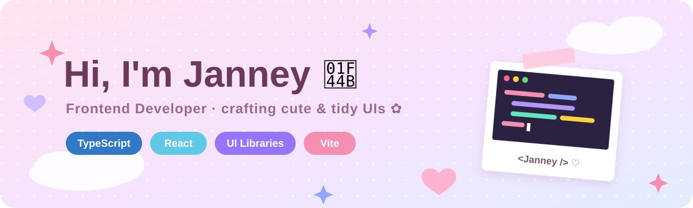

<!-- 🎀 วางไฟล์นี้ใน repo ชื่อ jellyjanney/jellyjanney แล้วอัปโหลด assets/banner.svg ไว้คู่กัน -->

<p align="center">
  
</p>

<p align="center">
  <a href="https://github.com/jellyjanney">
    
  </a>
</p>

<p align="center">
  
  
</p>

---

## 🌷 About me

<table>
<tr>
<td width="60%" valign="top">

- 💻 Frontend developer สาย **TypeScript + React + MUI**
- 🎨 ชอบทำ UI ที่ทั้ง **สวย น่ารัก และใช้งานง่าย**
- 🧩 เคยทำงานกับ legacy browser (Chrome &lt; 92) ด้วย polyfill
- 🌱 กำลังเล่นกับ **Vercel · Supabase · Claude Code**
- 📍 Bangkok, Thailand

</td>
<td width="40%" align="center">

```ts
const janney = {
  role: "Frontend Dev",
  stack: ["TS", "React", "MUI"],
  loves: ["pastel UI", "clean code"],
  mood: "☕ + 🎀",
};
```

</td>
</tr>
</table>

## 🧸 Tech stack

<p align="center">
  
  <br/>
  
</p>

## 🍓 Featured projects

<table>
<tr>
<td width="50%" valign="top">

### 🗓️ [Work Planner](https://github.com/jellyjanney/work-planner-web)
แปลง planner จาก Google Sheet มาเป็นเว็บแอป  
มีหน้า calendar · task list · detail view


🔗 [Live demo](https://work-planner-web.vercel.app)

</td>
<td width="50%" valign="top">

### 🔗 Lynki.me
Multi-tenant link-in-bio platform  
หน้า public สวยๆ + หลังบ้านให้เจ้าของแก้เองได้


<!-- TODO: ใส่ลิงก์ repo / live demo -->

</td>
</tr>
</table>

## 📊 GitHub stats

<p align="center">
  
  
</p>

<p align="center">
  
</p>

---

<p align="center">
  
</p>
